 

Hola, soy Martin 👋. Estudio Ingeniería en Informática en Duoc UC, en Viña del Mar.

Me gusta entender cómo funcionan las cosas por dentro. Casi siempre eso termina en una de dos:
armar algo que se levante entero con un comando, o desarmar algo ajeno para ver por dónde se entra.
Paso el día entre contenedores, terminales y CTF.

 

## Cómo trabajo

## Stack

## Proyectos

<table>
  <tr>
    <td width="50%" valign="top">
      <h3>&nbsp; <a href="https://github.com/Martinnnn-ops/cacha-el-precio">Cacha el Precio</a></h3>
      
      
Las tiendas anuncian descuentos contra un precio normal que nadie comprueba. Cacha el Precio revisa seis tiendas chilenas y guarda cómo cambia cada prenda. Vive en <a href="https://www.cacha-el-precio.com">cacha-el-precio.com</a>.

      <ul>
        <li>Un catálogo con filtros por talla, prenda y presupuesto</li>
        <li>El historial de precio de cada prenda, tienda por tienda</li>
        <li>Un armario para guardar prendas y armar outfits</li>
        <li>Un correo cuando algo baja, se agota o vuelve</li>
      </ul>
      

    </td>
    <td width="50%" valign="top">
      <h3>&nbsp; <a href="https://github.com/MartinMDevv/lock-in">Lock In</a></h3>
      
      
Horario, tareas, gimnasio y plata en una sola app instalable. No quiere ganarle a ninguna app en lo suyo: quiere ser la única que hay que abrir cada mañana.

      <ul>
        <li>La pantalla «Hoy» responde qué toca hacer hoy</li>
        <li>Rutinas con la carga de la vez pasada, récords y racha</li>
        <li>Plata en sobres; un gasto se anota en menos de 5 segundos</li>
        <li>Funciona sin señal y se sincroniza sola al volver la red</li>
      </ul>
      

    </td>
  </tr>
  <tr>
    <td width="50%" valign="top">
      <h3>&nbsp; <a href="https://github.com/MartinMDevv/Argos_mvp">Argos</a></h3>
      
      
El guardián de cien ojos: vigila el mercado cripto en tiempo real y avisa solo cuando pasa algo que vale la pena mirar.

      <ul>
        <li>BTC y ETH en vivo, con un año de historia de contexto</li>
        <li>Alertas por precio, movimientos bruscos, volatilidad y volumen</li>
        <li>Avisos por Telegram y una IA local que no inventa números</li>
      </ul>
      

    </td>
    <td width="50%" valign="top">
      <h3>&nbsp; ChessQuery</h3>
      
      
Una plataforma para la escena de ajedrez de club en Chile: jugar, organizar torneos y seguir tu progreso en un solo lugar.

      <ul>
        <li>Partidas en vivo contra otros jugadores, en tiempo real</li>
        <li>Torneos que arman los propios clubes y organizadores</li>
        <li>Amigos, perfil público y modo espectador para ver partidas</li>
      </ul>
      

    </td>
  </tr>
</table>

Proyectos anteriores

 

- [FoodHub](https://github.com/MartinMDevv/Backend_FoodHubApp): app Android en Kotlin y Jetpack Compose, con su backend.
- [Fruit Season](https://github.com/MartinMDevv/FruitSeason_Backend): sitio en React con backend en Spring Boot.

## Certificaciones

## CTF

